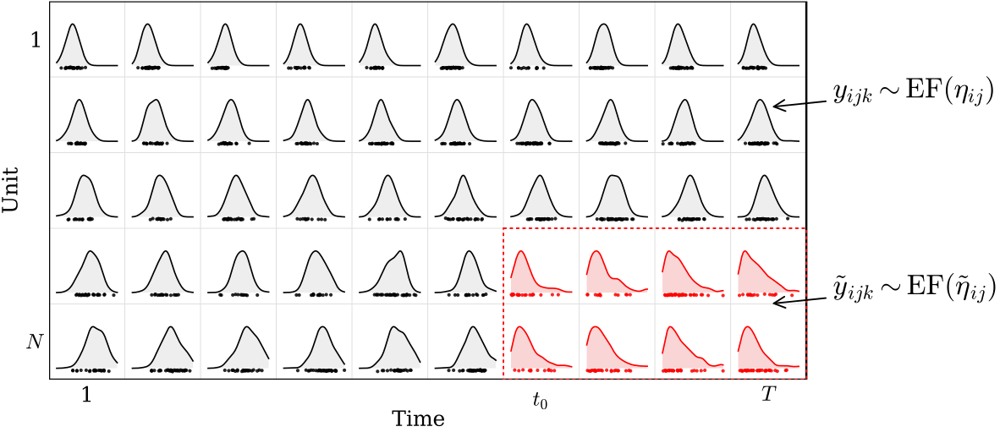
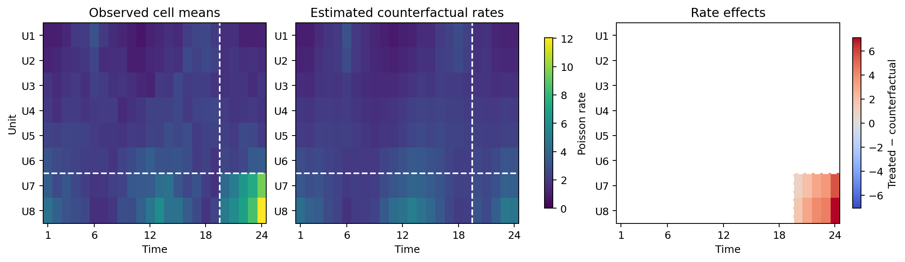

# EFSC — Exponential Family Synthetic Controls
**Probabilistic imputation and causal analysis for panels of datasets**

[](https://github.com/blei-lab/efsc/actions/workflows/python-package.yml?query=branch%3Amain)
[](https://www.python.org/downloads/)
[](LICENSE)
[](https://arxiv.org/abs/2609.23970)

<p align="center">
  
</p>

- Each unit-time cell contains a distribution of observations from an
  exponential family.
- An intervention at a specific time perturbs the distributions of a subset of
  units.
- Information sharing via probabilistic exponential-family matrix factorization.
- Black-box variational inference with automatic differentiation in PyTorch.
- Estimation of distributional counterfactuals and treatment effects.
- Dual functionality: probabilistic completion and synthetic controls.

| Input | Mode | Purpose |
|---|---|---|
| Long-format observations | [Imputation](docs/IMPUTATION.md) | Fit the panel and infer missing unit-time datasets |
| Long-format observations plus causal metadata—treated units and each unit's first treated period | [Causal/SC](docs/CAUSAL_ANALYSIS.md) | Estimate untreated counterfactual distributions |

Without causal metadata, EFSC performs probabilistic matrix completion using
the [factorization](docs/FACTORIZATION.md) underlying the model. With causal
metadata, EFSC estimates untreated counterfactual distributions and [treatment
effects](docs/CAUSAL_ESTIMANDS.md) using the synthetic-control design described
in the [paper](https://arxiv.org/abs/2609.23970). See the currently
available [distributions](docs/SUPPORTED_DISTRIBUTIONS.md) and the
guides to [imputation](docs/IMPUTATION.md) and
[causal/SC](docs/CAUSAL_ANALYSIS.md) modes.
Users can provide their own long-format [CSV files](docs/INPUT_DATA.md) or
[pandas DataFrames](docs/INPUT_DATA.md), and configure model fitting through the
available [inference settings](docs/INFERENCE.md). The [documentation
index](docs/README.md) and [example index](examples/README.md) collect the
complete guides and runnable scripts;
see the [imputation examples](examples/IMPUTATION.md) and
[causal/SC examples](examples/CAUSAL.md).

Code to reproduce the manuscript results is maintained in the companion
[`efsc-paper-reproduction`](https://github.com/blei-lab/efsc-paper-reproduction)
repository.

## Citation
If you use EFSC in your research, please cite:

```bibtex
@article{rodriguezdeniz2026efsc,
  author = {Rodriguez-Deniz, Hector and Blei, David M.},
  title = {Exponential Family Synthetic Controls},
  journal = {arXiv preprint arXiv:2609.23970},
  year = {2026},
  url = {https://arxiv.org/abs/2609.23970}
}
```

## Installation

EFSC requires Python 3.10 or newer. To install the current source:

```bash
git clone https://github.com/blei-lab/efsc.git
cd efsc
python -m venv myenv
source myenv/bin/activate
python -m pip install --upgrade pip
python -m pip install --editable .
```

For a CPU-only installation, install the CPU build of PyTorch first. This
avoids downloading CUDA libraries on machines that will not use a GPU:

```bash
python -m pip install torch --index-url https://download.pytorch.org/whl/cpu
python -m pip install --editable .
```

To run examples that generate figures, install the optional plotting
dependencies:

```bash
python -m pip install --editable ".[examples]"
```

For development and testing:

```bash
python -m pip install --editable ".[test,examples]"
python -W error -m pytest -p no:cacheprovider
```

## Quick start

This example simulates an 8-by-24 Poisson panel and treats its final two units
from period 20 onward. Each unit-time cell contains 32 observations. EFSC
then estimates the untreated counterfactual rates and distributional treatment
effects:

```python
from efsc import EFSC, InferenceConfig
from examples.poisson_synthetic_control import simulate_panel

panel, adoption = simulate_panel(random_state=123)

result = EFSC(
    family="poisson",
    rank=1,
    random_state=123,
    inference_config=InferenceConfig(epochs=2000, device="cpu"),
).fit(
    panel,
    outcome="outcome",
    unit="unit",
    time="time",
    causal_metadata=adoption,
)

effects = result.causal.effects
print(
    effects.groupby("unit", as_index=False)[
        ["counterfactual_rate", "treated_rate", "difference_rate", "ecd"]
    ].mean()
)
```

```text
unit  counterfactual_rate  treated_rate  difference_rate      ecd
  U7             3.144352      6.167707         3.023355 1.267228
  U8             3.768525      7.799882         4.031357 1.740297
```

<p align="center">
  
</p>

The dashed lines mark the treated units and the first treated period. The
complete runnable script can also regenerate the figure when Matplotlib is
installed; see
[`examples/poisson_synthetic_control.py`](examples/poisson_synthetic_control.py).
