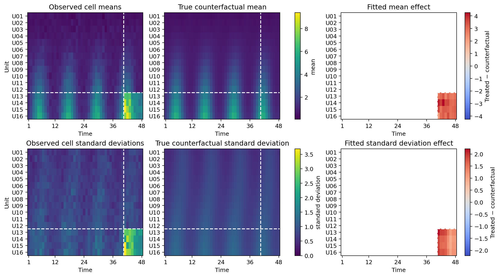
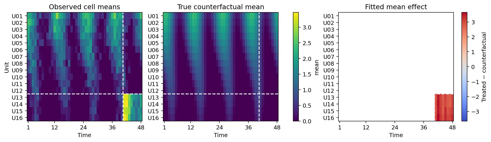
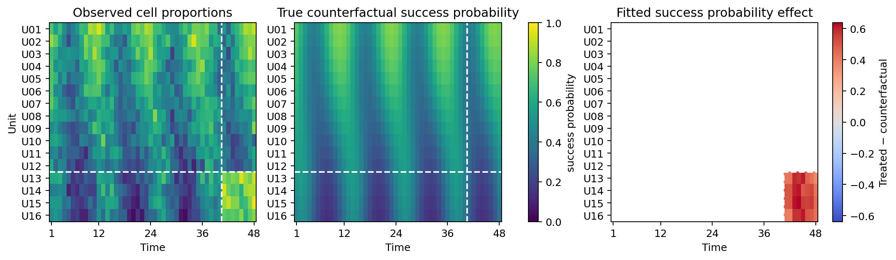
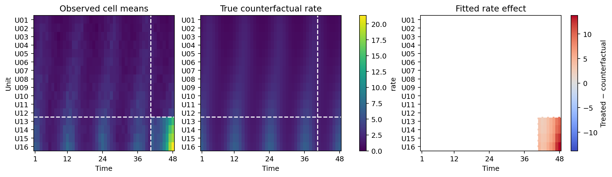
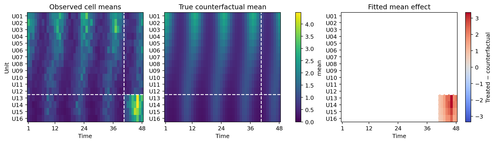
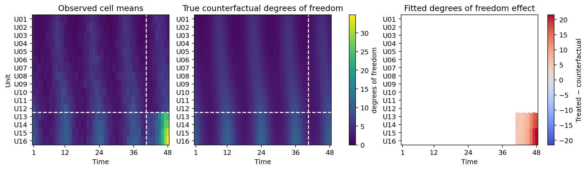
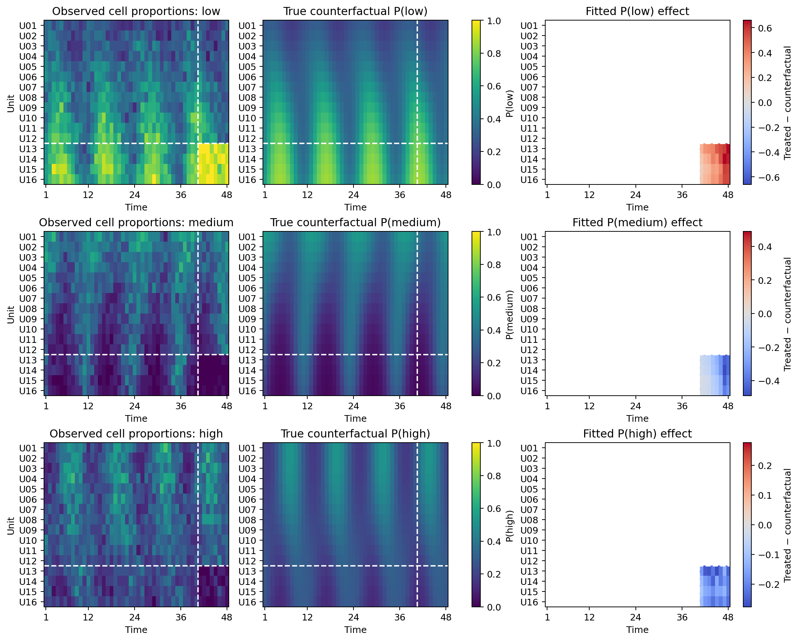

# EFSC causal/synthetic-control examples

[Example index](README.md) · [Imputation examples](IMPUTATION.md) ·
[Main README](../README.md) · [Causal-analysis guide](../docs/CAUSAL_ANALYSIS.md)

## Quick start - CSV datafiles

EFSC accepts raw observations in a long-format CSV file and absorbing-treatment
adoption times in a second CSV file. The following example fits a
two-parameter Gaussian model to the bundled
[`gaussian_causal_toy.csv`](data/gaussian_causal_toy.csv) panel using
[`gaussian_causal_metadata_toy.csv`](data/gaussian_causal_metadata_toy.csv):

```python
from efsc import EFSC, InferenceConfig

model = EFSC(
    family="gaussian",
    rank=1,
    random_state=123,
    inference_config=InferenceConfig(
        epochs=20,
        learning_rate=0.03,
        device="cpu",
    ),
)

result = model.fit_csv(
    "examples/data/gaussian_causal_toy.csv",
    outcome="outcome",
    unit="unit",
    time="time",
    causal_metadata="examples/data/gaussian_causal_metadata_toy.csv",
)

print(
    result.causal.effects[["unit", "time", "difference_mean", "ecd"]]
    .to_string(index=False)
)
```

The bundled files represent a 4-by-6 panel in which units A and B adopt
treatment in 2013 and 2014, respectively, while units C and D are never
treated. Running the example produces:

```text
unit  time  difference_mean      ecd
   A  2013         1.088865 0.588729
   A  2014         1.503706 1.243634
   A  2015         1.527497 1.238032
   B  2014         1.091432 0.528320
   B  2015         1.094983 0.509923
```

Replace the paths with your own panel and adoption-metadata files. Adoption
metadata can also be supplied as a mapping or pandas DataFrame; see the
[causal/SC guide](../docs/CAUSAL_ANALYSIS.md).

The complete runnable CSV-loading script is:

```bash
python examples/gaussian_causal_quickstart.py
```

## EF examples - simulated data

Each example simulates a 16-by-48 panel with 32 observations from the
corresponding exponential family in every unit-time cell. The final four units
are treated simultaneously from period 41 onward. Population parameters come
from family-specific additive-plus-rank-one counterfactual surfaces. Fixed
family-specific parameter shifts perturb the treated-post distributions. EFSC
fits separate counterfactual and treated models for 2,000 VI iterations by
default. The examples are designed as API demonstrations, not statistical
benchmarks.

Run an example from the repository root:

```bash
python examples/causal/poisson_causal.py \
  --figure gallery/poisson_causal.png
```

| Family | Example Code | Input-format Sample | Estimated Parameters | Fixed Parameters |
|---|---|---|---|---|
| Gaussian | [`causal/gaussian_causal.py`](causal/gaussian_causal.py) | [`gaussian_causal_toy.csv`](data/gaussian_causal_toy.csv) | mean and standard deviation | |
| Gaussian with known scale | [`causal/gaussian_known_sigma_causal.py`](causal/gaussian_known_sigma_causal.py) | [`gaussian_known_sigma_toy.csv`](data/gaussian_known_sigma_toy.csv) | mean | `sigma=1.5` |
| Bernoulli | [`causal/bernoulli_causal.py`](causal/bernoulli_causal.py) | [`bernoulli_toy.csv`](data/bernoulli_toy.csv) | success probability | |
| Poisson | [`causal/poisson_causal.py`](causal/poisson_causal.py) | [`poisson_toy.csv`](data/poisson_toy.csv) | rate | |
| Exponential | [`causal/exponential_causal.py`](causal/exponential_causal.py) | [`exponential_toy.csv`](data/exponential_toy.csv) | mean | |
| Laplace with known location | [`causal/laplace_known_mu_causal.py`](causal/laplace_known_mu_causal.py) | [`laplace_known_mu_toy.csv`](data/laplace_known_mu_toy.csv) | scale | `mu=0.25` |
| Chi-square | [`causal/chi_square_causal.py`](causal/chi_square_causal.py) | [`chi_square_toy.csv`](data/chi_square_toy.csv) | degrees of freedom | |
| Multinomial | [`causal/multinomial_causal.py`](causal/multinomial_causal.py) | [`multinomial_toy.csv`](data/multinomial_toy.csv) | all category probabilities | |

The linked CSVs are deliberately compact so they can be visually inspected.
The example scripts that produce the figures below do not fit these toy
datasets; they simulate the larger 16-by-48 panels in memory. For an example
that directly loads data and causal metadata from CSV files, see the quick
start example above.

## Gaussian causal/SC - unknown scale

The two-parameter Gaussian example estimates counterfactual means and standard
deviations after an intervention that perturbs both parameters:

```bash
python examples/causal/gaussian_causal.py \
  --figure docs/assets/gaussian_causal.png
```

<p align="center">
  
</p>

Dashed lines mark the treated units and first treated period. The second column
displays the true untreated counterfactuals, and the third column displays the
fitted treated-minus-counterfactual effects.

## Gaussian causal/SC - known scale

```bash
python examples/causal/gaussian_known_sigma_causal.py \
  --figure docs/assets/gaussian_known_sigma_causal.png
```

<p align="center">
  
</p>

## Bernoulli causal/SC

```bash
python examples/causal/bernoulli_causal.py \
  --figure docs/assets/bernoulli_causal.png
```

<p align="center">
  
</p>

## Poisson causal/SC

```bash
python examples/causal/poisson_causal.py \
  --figure docs/assets/poisson_causal.png
```

<p align="center">
  
</p>

## Exponential causal/SC

```bash
python examples/causal/exponential_causal.py \
  --figure docs/assets/exponential_causal.png
```

<p align="center">
  
</p>

## Laplace causal/SC - known location

```bash
python examples/causal/laplace_known_mu_causal.py \
  --figure docs/assets/laplace_known_mu_causal.png
```

<p align="center">
  
</p>

## Chi-squared causal/SC

```bash
python examples/causal/chi_square_causal.py \
  --figure docs/assets/chi_square_causal.png
```

<p align="center">
  
</p>

## Multinomial causal/SC

```bash
python examples/causal/multinomial_causal.py \
  --figure docs/assets/multinomial_causal.png
```

<p align="center">
  
</p>
