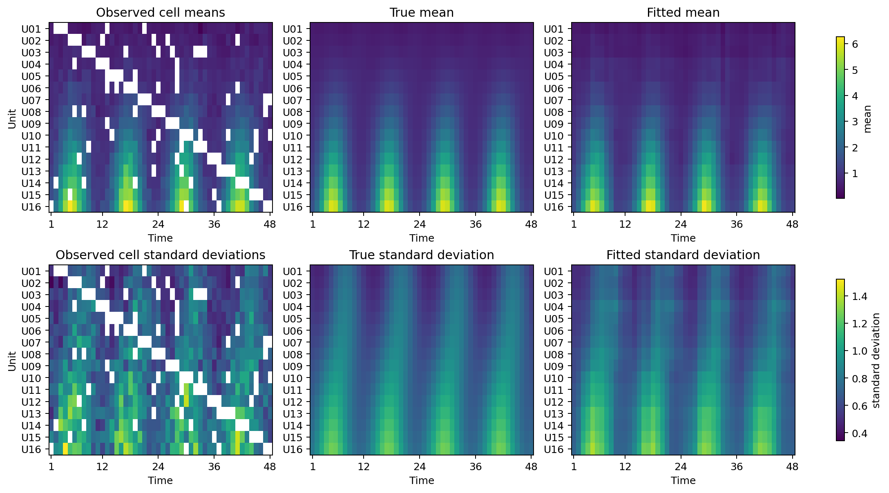
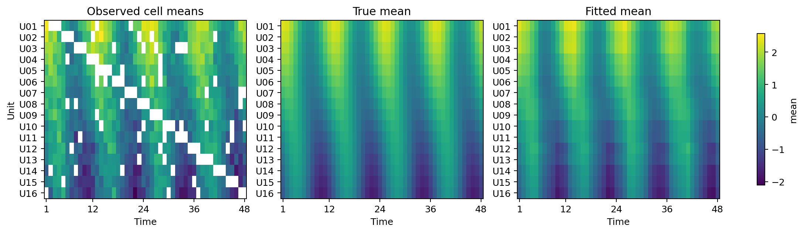
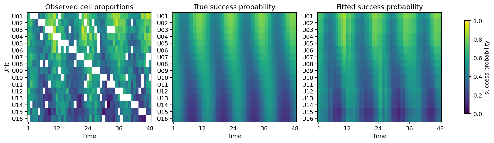
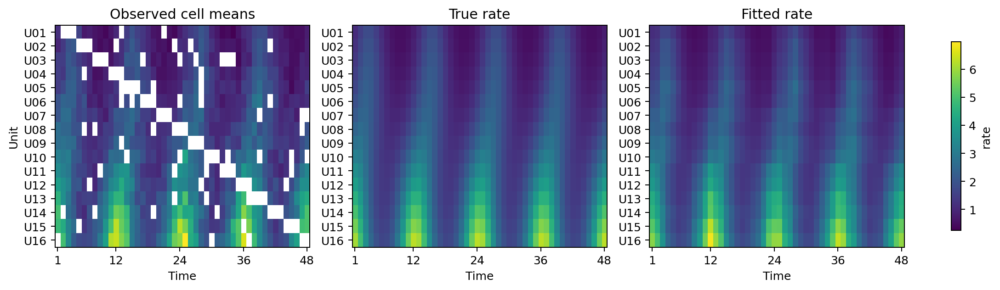
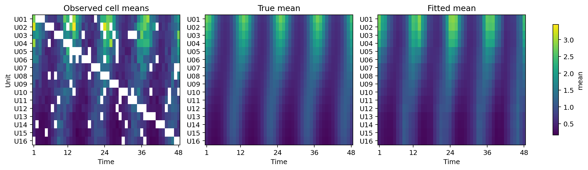
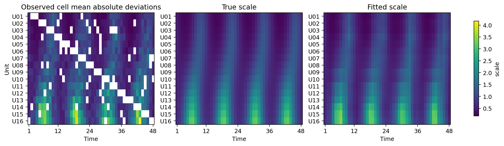
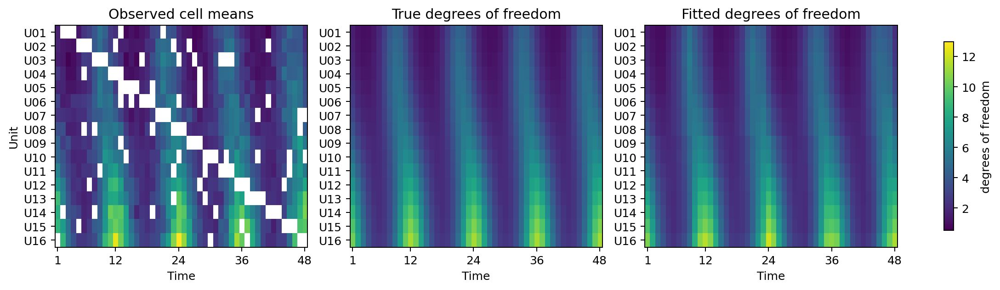
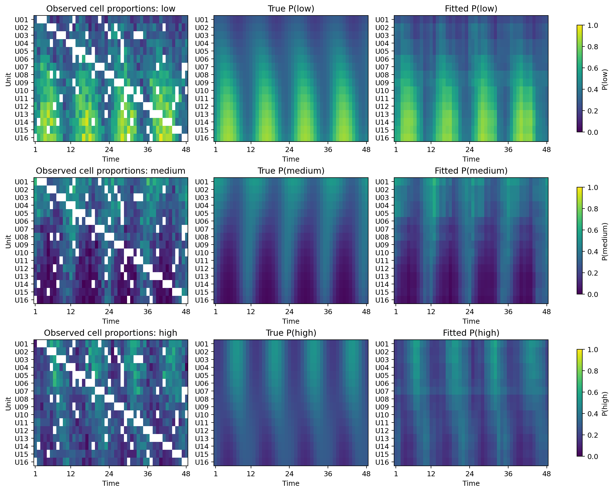

# EFSC imputation examples

[Example index](README.md) · [Causal examples](CAUSAL.md) ·
[Main README](../README.md) ·
[Supported distributions](../docs/SUPPORTED_DISTRIBUTIONS.md)

## Quick start - CSV datafile

EFSC accepts raw observations in a long-format CSV file. Each row contains one
observation together with its unit and time labels; unit-time combinations
that do not appear in the file are treated as missing cells. The following
example fits a two-parameter Gaussian model to the bundled
[`gaussian_panel_toy.csv`](data/gaussian_panel_toy.csv) file:

```python
from efsc import EFSC, InferenceConfig

model = EFSC(
    family="gaussian",
    rank=1,
    random_state=123,
    inference_config=InferenceConfig(epochs=2000, device="cpu"),
)

result = model.fit_csv(
    "examples/data/gaussian_panel_toy.csv",
    outcome="outcome",
    unit="unit",
    time="time",
)

print("Imputed parameters for missing cells:")
print(
    result.imputations[["unit", "time", "mean", "variance"]].to_string(
        index=False
    )
)
```

The bundled file represents a 3-by-4 panel with eight observed and four
missing cells. Running the example produces:

```text
Imputed parameters for missing cells:

unit  time     mean  variance
   A  2013 5.029170  0.803398
   B  2011 0.540833  0.231967
   C  2010 0.074419  0.066950
   C  2012 0.181928  0.116589
```

Replace the path with your own CSV file. If the observations are already in a
pandas DataFrame, pass it directly to the model's `fit` method:

```python
import pandas as pd

data = pd.read_csv("my_panel.csv")  # Or use an existing DataFrame.
result = model.fit(
    data,
    outcome="outcome",
    unit="unit",
    time="time",
)
```

The complete runnable CSV-loading script is:

```bash
python examples/gaussian_imputation_quickstart.py
```

## EF examples - simulated data

Each example simulates a 16-by-48 panel with 32 observations from the
corresponding exponential family in every observed unit-time cell. Population
parameters come from family-specific additive-plus-rank-one predictor
surfaces, and observations are then sampled from the corresponding
distribution using a distinct seed for each family. A common missingness mask
removes three consecutive cells per unit in a diagonal pattern and 7.5% of the
remaining cells at random. EFSC fits the remaining cells for 2,000 VI
iterations by default. The examples are designed as API demonstrations, not
statistical benchmarks.

Run an example from the repository root:

```bash
python examples/imputation/poisson_imputation.py \
  --figure gallery/poisson_imputation.png
```

| Family | Example Code | Input-format Sample | Estimated Parameters | Fixed Parameters |
|---|---|---|---|---|
| Gaussian | [`imputation/gaussian_imputation.py`](imputation/gaussian_imputation.py) | [`gaussian_panel_toy.csv`](data/gaussian_panel_toy.csv) | mean and standard deviation | |
| Gaussian with known scale | [`imputation/gaussian_known_sigma_imputation.py`](imputation/gaussian_known_sigma_imputation.py) | [`gaussian_known_sigma_toy.csv`](data/gaussian_known_sigma_toy.csv) | mean | `sigma=1.5` |
| Poisson | [`imputation/poisson_imputation.py`](imputation/poisson_imputation.py) | [`poisson_toy.csv`](data/poisson_toy.csv) | rate | |
| Bernoulli | [`imputation/bernoulli_imputation.py`](imputation/bernoulli_imputation.py) | [`bernoulli_toy.csv`](data/bernoulli_toy.csv) | success probability | |
| Exponential | [`imputation/exponential_imputation.py`](imputation/exponential_imputation.py) | [`exponential_toy.csv`](data/exponential_toy.csv) | mean | |
| Laplace with known location | [`imputation/laplace_known_mu_imputation.py`](imputation/laplace_known_mu_imputation.py) | [`laplace_known_mu_toy.csv`](data/laplace_known_mu_toy.csv) | scale | `mu=0.25` |
| Chi-square | [`imputation/chi_square_imputation.py`](imputation/chi_square_imputation.py) | [`chi_square_toy.csv`](data/chi_square_toy.csv) | degrees of freedom | |
| Multinomial | [`imputation/multinomial_imputation.py`](imputation/multinomial_imputation.py) | [`multinomial_toy.csv`](data/multinomial_toy.csv) | all category probabilities | |

The linked CSVs are deliberately compact so they can be visually inspected.
The example scripts that produce the figures below do not fit these toy
datasets; they simulate the larger 16-by-48 panels in memory. For an example
that directly loads data from a CSV file, see the quick start example above.

## Gaussian imputation - unknown scale

The two-parameter Gaussian example estimates and imputes both cell means and
standard deviations:

```bash
python examples/imputation/gaussian_imputation.py \
  --figure docs/assets/gaussian_imputation.png
```

<p align="center">
  
</p>

White cells in the observed panels are omitted during fitting. The middle
column displays the true simulated parameters, and the right column displays
their EFSC estimates.

## Gaussian imputation - known scale

```bash
python examples/imputation/gaussian_known_sigma_imputation.py \
  --figure docs/assets/gaussian_known_sigma_imputation.png
```

<p align="center">
  
</p>

## Bernoulli imputation

```bash
python examples/imputation/bernoulli_imputation.py \
  --figure docs/assets/bernoulli_imputation.png
```

<p align="center">
  
</p>

## Poisson imputation

```bash
python examples/imputation/poisson_imputation.py \
  --figure docs/assets/poisson_imputation.png
```

<p align="center">
  
</p>

## Exponential imputation

```bash
python examples/imputation/exponential_imputation.py \
  --figure docs/assets/exponential_imputation.png
```

<p align="center">
  
</p>

## Laplace imputation - known location

```bash
python examples/imputation/laplace_known_mu_imputation.py \
  --figure docs/assets/laplace_known_mu_imputation.png
```

<p align="center">
  
</p>

## Chi-squared imputation

```bash
python examples/imputation/chi_square_imputation.py \
  --figure docs/assets/chi_square_imputation.png
```

<p align="center">
  
</p>

## Multinomial imputation

```bash
python examples/imputation/multinomial_imputation.py \
  --figure docs/assets/multinomial_imputation.png
```

<p align="center">
  
</p>
